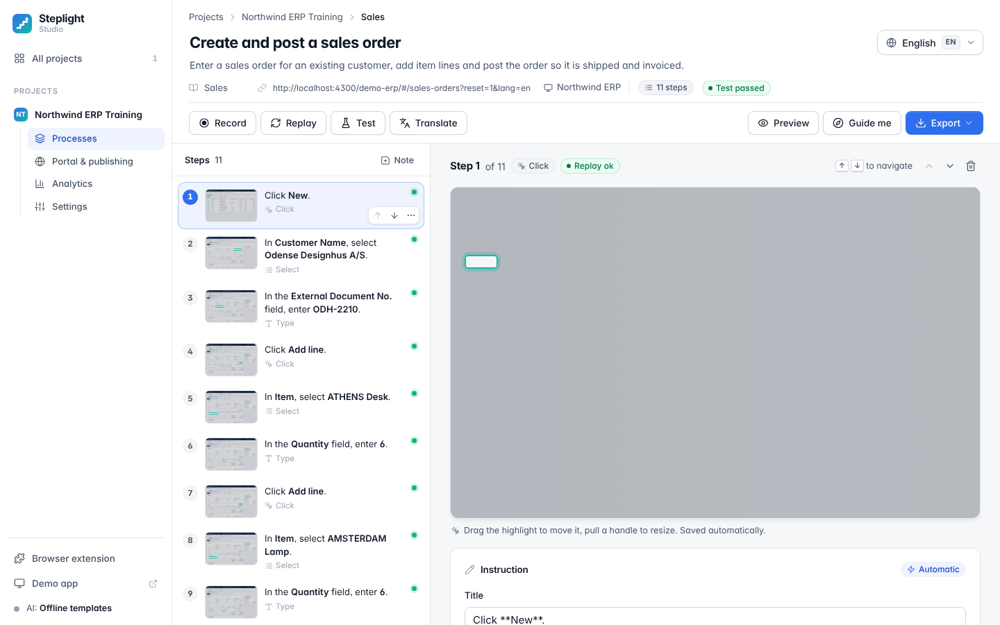
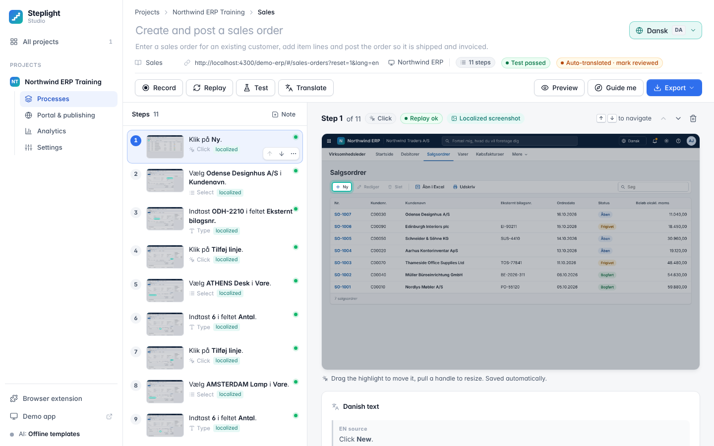
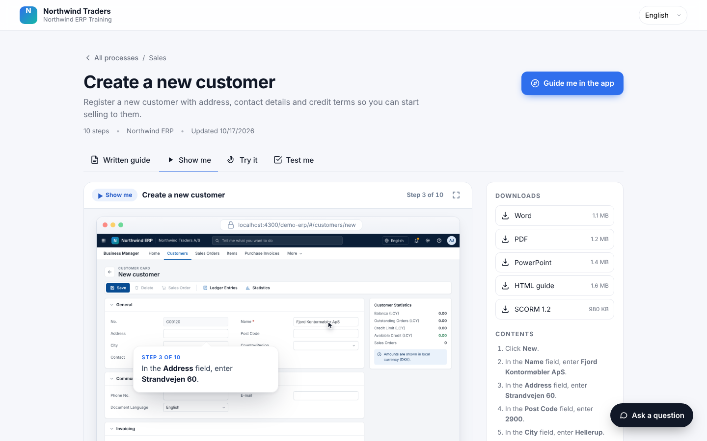
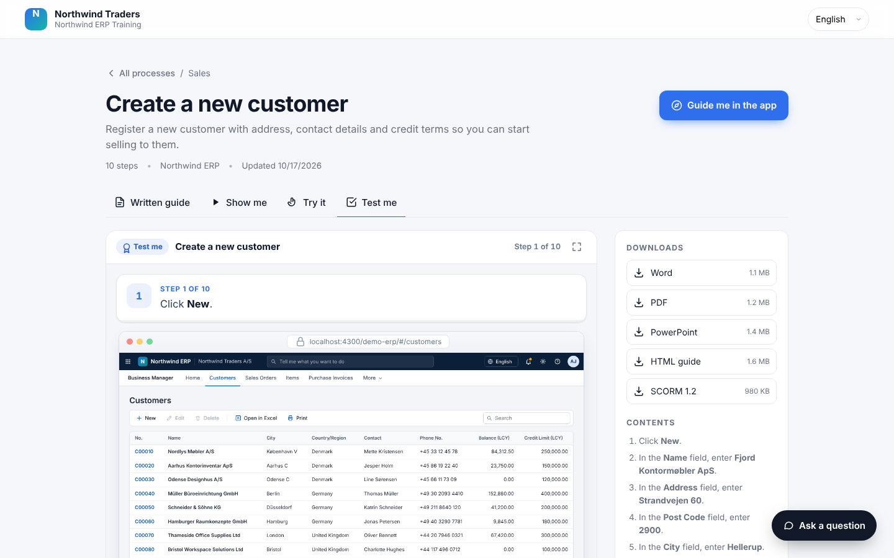
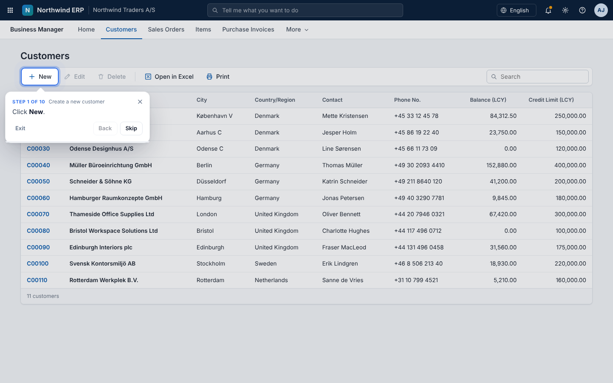
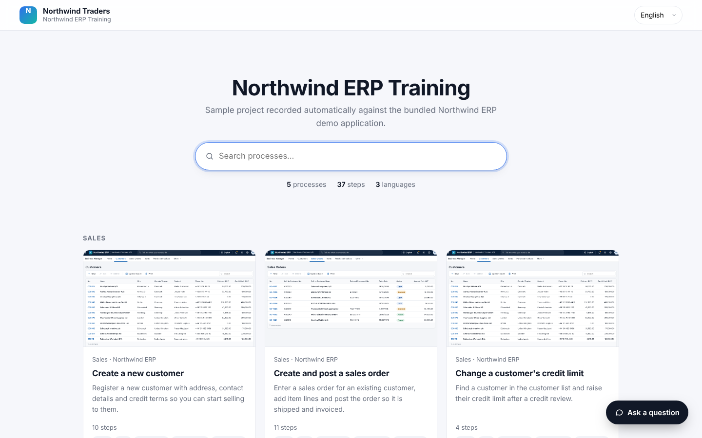
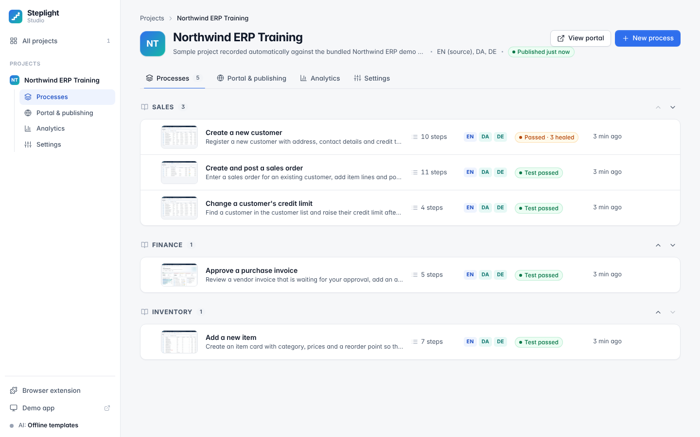
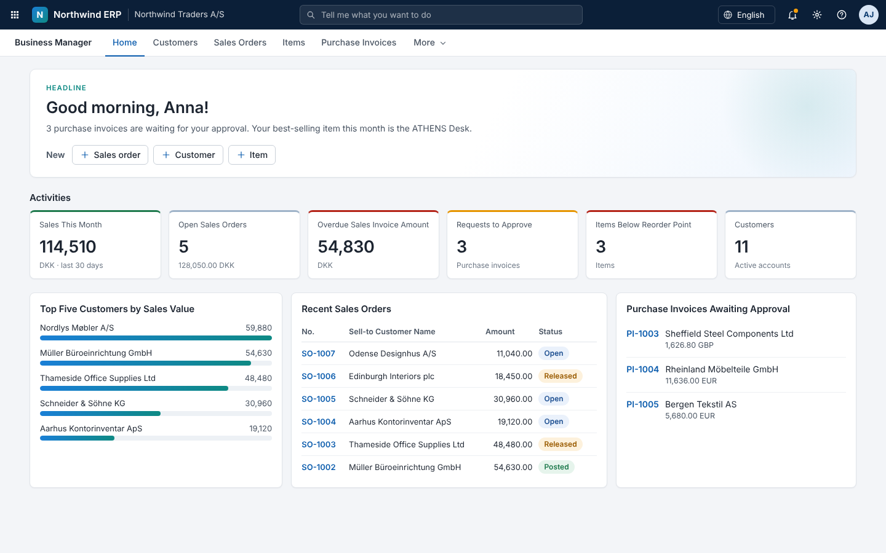

# Steplight

**Record a business process once. Publish documentation, interactive training and in-app guidance in every format and language — and keep it up to date automatically.**

Steplight is an open, browser-first take on what [ClickLearn](https://www.clicklearn.com/) does for enterprise software (see the full teardown in [`research/`](research/CLICKLEARN_ANALYSIS.md)). An author clicks through a process in a web application; Steplight captures every step and generates everything a rollout needs from that single recording.



## What you get from one recording

| Output | What it is |
|---|---|
| **Show Me** | Narrated, animated walkthrough (cursor, highlights, typing) with speed control and voice-over |
| **Try Me** | Hands-on simulation — the learner performs each step on the screenshots with hints |
| **Test Me** | Scored assessment with pass mark and per-step review |
| **Assist** | Live in-app guidance: highlights the real element in the running application and advances as the user works |
| **Word / PDF / PowerPoint** | Branded, print-ready training documents with annotated screenshots |
| **HTML guide** | One self-contained, responsive written guide |
| **SCORM 1.2** | LMS package (Try Me + Test Me) reporting completion and score |
| **Video (WebM)** | Show Me rendered to a video file |
| **Learning portal** | Branded static site: search, chapters, every format, downloads, language switcher, **AI help chat**, embeddable |

Plus the mechanics that make it maintainable:

- **Replay** — re-runs the recording against the current version of the application, refreshing every screenshot and highlight. Self-healing selectors keep working when the UI changes.
- **Automated process testing** — the same replay in test mode reports which steps pass, heal or fail (regression testing for business processes).
- **Localization without re-recording** — a *localized replay* drives the application in another UI language, captures localized screenshots and the real localized element names, and regenerates every instruction from built-in templates (7 languages: en, da, de, fr, es, nl, sv). Author-written text is machine-translated by Claude when configured.
- **Analytics** — views, completions, test scores, downloads and search queries per process.
- **Browser extension** — records in Chrome/Edge, and its side panel suggests guides for the page you're on (a "user experience panel").
- **Import a Word guide** — upload a written guide you already have (`.docx`). Claude reads its steps and screenshots and drafts the process: the instructions, the elements they name, the guide's screenshots as placeholders, and a flag on every step the author should check. Without an API key, rules read the common phrasings ("Click **New**", "In the **Name** field, enter …").

## Quick start

Requires Node 22+. Chromium for Playwright must be available (`npx playwright install chromium` if you don't have it).

```bash
npm install
npm run build        # browser libraries, extension and Studio
npm start            # http://localhost:4100
```

Open **http://localhost:4100/studio/** and click **Create sample project**: Steplight records several processes against the bundled **Northwind ERP** demo app (`/demo-erp/`) in a headless browser. Then open a process to edit steps, Replay, Test, Translate, Preview, Guide me, Export — and **Publish** the portal.

Record your own processes with the browser extension:

1. `npm run build`, then open `chrome://extensions`, enable Developer mode, **Load unpacked** → `dist/extension`.
2. In the extension popup, set the server URL, pick or create a process, press **Start recording**, and click through your application.

### Put it on your own domain

Docker image, Cloudflare Tunnel and a Worker route for serving Steplight under a path such as `https://examplewebsite.app/steplight`: see [`docs/DEPLOY.md`](docs/DEPLOY.md).

### Configuration

| Variable | Default | Purpose |
|---|---|---|
| `PORT` | `4100` | HTTP port |
| `STEPLIGHT_BASE_URL` | `http://localhost:$PORT` | Public URL, including a path prefix if served under one (e.g. `https://examplewebsite.app/steplight`) |
| `STEPLIGHT_ACCESS_KEY` | — | Requires this key for the Studio and authoring API (portals, players and Assist stay public) |
| `STEPLIGHT_INTERNAL_URL` | `http://127.0.0.1:$PORT<prefix>` | How the server's own headless browser reaches it |
| `STEPLIGHT_DATA` | `./data` | Where projects, screenshots and published portals are stored (plain JSON + PNG) |
| `ANTHROPIC_API_KEY` | — | Enables Claude for AI help answers and translation of author-written text |
| `STEPLIGHT_MODEL` | `claude-opus-5-5` | Claude model |
| `STEPLIGHT_AI` | auto | `off` forces offline mode; `on` uses other Anthropic credential sources |

Without an API key everything still works: AI help answers by retrieval over the documented processes, and instructions are localized by templates + localized replay.

## Screenshots

| | |
|---|---|
|  **Studio — process editor** |  **Danish version from a localized replay** |
|  **Show Me player in the portal** |  **Test Me assessment** |
|  **Assist guiding inside the live app** |  **Learning portal** |
|  **Processes with automated test status** |  **Bundled Northwind ERP demo app** |

## How it works

```
Browser extension ─┐                                   ┌─ Word · PDF · PowerPoint · HTML
Scripted recorder ─┼─► capture events ─► steps (JSON) ─┼─ Show Me · Try Me · Test Me · Video
   (Playwright)    │   + screenshots      + localizations├─ SCORM 1.2 package
                   │                                    ├─ Learning portal + AI help
            Replay / Test (Playwright) ◄───────────────┘─ Assist (live in-app overlay)
```

- **Capture** (`src/capture`) runs in the page: it derives an element's role, accessible name, label and a ranked list of selectors (test ids, stable ids, role+name, label, placeholder, text, CSS path) and emits click / type / select / check / press events. The server merges noise (focus clicks, keystroke-by-keystroke typing) into clean steps and writes the instruction text.
- **Replay** (`src/replay`) resolves each step's element with the same selector logic, screenshots it before acting, performs the action, and reports `ok` / `healed` / `failed`.
- **Generators** (`src/generators`) render a *resolved* process (localized texts and media) into each format. **Players** (`src/players`) and **Assist** (`src/assist`) are framework-free browser bundles.
- **Studio** (`studio/`) is the React authoring app; the **portal** (`src/portal`) is a static site you can host anywhere or download as a zip.

Architecture, data model and API: [`docs/ARCHITECTURE.md`](docs/ARCHITECTURE.md).

## Development

```bash
npm run dev          # server with reload
npm run typecheck
npm test             # unit + browser tests (vitest + Playwright)
npm run e2e          # full pipeline against the demo app; -- --shots refreshes docs/screenshots
npm run fixtures     # sample process with real screenshots for generator/player work
```

## Steplight vs. ClickLearn

| ClickLearn | Steplight |
|---|---|
| Windows desktop authoring client (.NET, 16 GB RAM) | Browser extension + web Studio, any OS |
| Records Windows and web apps | Records web apps (Windows thick clients are out of scope) |
| 7 output formats | Same 7 (Show/Try/Test, Word, PDF, PowerPoint, Assist) + HTML, SCORM, video, portal |
| Replay to update content | Replay with self-healing selectors + localized replay |
| Automated Process Testing (Enterprise tier) | Test mode included |
| 45 languages via auto-translation | 7 template languages + Claude translation for free text |
| UXP side panel with AI chat | Extension side panel + portal AI help (Claude or offline) |
| Quote-based pricing, ~$4.5k–$27.5k/yr + per author/user | Open source, self-hosted |
